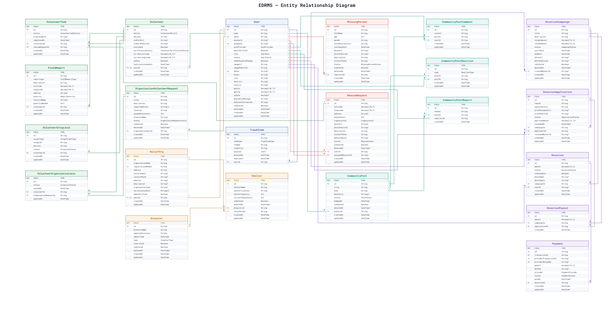

# Emergency Disaster Response & Management System

## Live Link: [edrms-frontend-next-js.vercel.app](https://edrms-frontend-next-js.vercel.app/)

# 1. Project Overview

## 1.1 Problem Statement

During disasters, affected people, volunteers, and relief organizations often lack a centralized platform for effective communication and coordination. This project aims to combine emergency reporting, rescue operations, volunteer management, and relief distribution through an integrated web application.

## 1.2 System Roles

* Users
* Volunteers
* Relief Org
* Admin

## 1.3 Role-Based Functionalities

### Users

Users register and manage a personal profile, receive official disaster alerts, and save medical and emergency information. They report disasters with location, request rescue or assistance, share live location, and find nearby shelters or volunteers. Users can donate or request donations, submit missing-person reports, confirm safety with “I’m Safe,” and track rescue request status.

### Volunteers

Volunteers register and apply for verification, then add rescue skills and set availability. They see nearby matching requests, accept or reject tasks, share live location while on duty, and update task progress. Volunteers also report blocked routes or resource shortages and mark tasks completed.

### Relief Organizations

Relief organizations register and complete verification, publish official disaster alerts, and create/manage donations and volunteer groups. They assign volunteers and resources, manage relief camps and inventory, and monitor camp capacity and facilities. Organizations track operations and generate reports to coordinate relief efforts.

### Admins

Admins manage all accounts and verify or approve public warnings, posts, volunteers, and organizations. They review disaster reports and critical rescue requests, detect duplicates, monitor ongoing operations, and flag suspicious donation activity. Admins also moderate community content and generate disaster response reports.

---

# 2. Additional Features

## Frontend

* Zod for form validation
* OAuth for authentication
* AI Chatbot (Toolcalling) using Gemini API (Access to all public GET API only)
* Proxy for hiding backend endpoints
* Skeletons & loaders for all components
* Environment-based configuration using `.env`
* File upload (e.g., profile image or documents)
* Soft Deletetion & Trash
* PDF Generation using React PDF
* Stripe & Bkash Integration
* Toast for confirmation for every action.
* Global custom error handling page, redirect to `/home` if not authorized
* Custom UI Library (Shadcn, Material UI, Universe io)
* Central Endpoint API Addressbook
* Dynamic Navbar with role-based navlinks.
* Open Street Maps integration.

### Implementation Highlights

* Modern design, mobile responsiveness, and consistent theming [responsive public directories, dashboard layouts and sidebars, shared Tailwind theme tokens in `app/globals.css`, and global Google Sans typography through `app/layout.tsx` and `components/font-provider.tsx`].
* Accessibility features [labelled search and navigation buttons, `aria-invalid` and `aria-describedby` on form fields, keyboard focus styles, and labelled MUI pagination in shared components].
* Server/Client component split [server-rendered public list/detail `page.tsx` files and interactive `client.tsx` components in missing persons, rescue requests, disasters, donations, and community].
* App Router features, shared layouts, and error boundaries [dynamic `[id]` routes, root/auth/protected/admin layouts, `app/loading.tsx`, `app/error.tsx`, and `app/not-found.tsx`].
* Authentication flow, protected routes, and role-based UI for four roles [sign-in/OAuth and session state in `AuthProvider`; client-side guards in `RouteFallbackControl` and `RoleRoute`; role-specific navigation for User, Volunteer, Relief Org, and Admin].
* Data fetching strategy and caching [fresh public SSR reads in `lib/server/public-data.ts`; account-scoped SWR list/profile caches in `usePaginatedList` and `useUserProfile`; cache refresh after successful writes in `lib/api.ts`].
* Global state and loading states [authentication through React Context in `AuthProvider`; shared toast state in `components/ui/toast.tsx`; route skeletons and dashboard loading indicators].
* Optimistic UI updates [community post likes update the displayed reaction state and count before the API request finishes in `components/community/community-post-card.tsx` and `app/community/[id]/client.tsx`].
* Zod validation, user-friendly errors, and complex workflows [schemas in `lib/validations`; inline form errors for missing-person/rescue reports and registration; donation checkout, aid applications, and volunteer verification workflows].
* Image optimization, lazy loading, and code splitting [Next.js `Image` in missing-person/community cards and public detail pages; dynamic imports for add/edit drawers and maps; chatbot code loaded on first open in `components/lazy-chatbot.tsx`].
* URL state management with `useSearchParams` [search/filter query parameters through `hooks/use-url-state.ts`; donation payment return parameters in the success/cancel pages].
* Component modularity, custom hooks, and TypeScript typing [shared UI components, `DashboardFrame`, typed record interfaces, and the `useAuth`, `usePaginatedList`, `useUserProfile`, and `useUrlState` hooks].
* Working production URL, environment configuration, and automatic deployment [Vercel live URL above; `BACKEND_URL` rewrites in `next.config.ts`; environment variables for API/chat configuration; GitHub `main` pushes trigger Vercel deployments].

# 3. Rendering & Caching

Pages can combine server-rendered content with client-side interactions. The columns below list where each approach is used; entries in the same row do not imply a relationship.

| SSR | CSR | Cached |
| --- | --- | --- |
| Missing persons directory and details: `/missing-persons`, `/missing-persons/[id]` | Public search, filters, MUI pagination, and add/edit drawers | Home page (`/`): statically prerendered HTML cached by Next.js |
| Rescue requests directory and details: `/rescue-requests`, `/rescue-requests/[id]` | User, volunteer, relief organization, and admin dashboards: authenticated data fetched in the browser | `usePaginatedList`: SWR results keyed by account, endpoint, filters, and page; duplicate requests deduplicated for 2 seconds |
| Disaster directory and details: `/disaster`, `/disaster/[id]` | Authentication, registration, and profile forms | `useUserProfile`: account-scoped SWR profile cache; duplicate requests deduplicated for 10 seconds |
| Donation campaigns and details: `/donations`, `/donations/[id]` | Community comments and likes, donation/payment actions, and interactive maps | Public server fetches: React `cache()` deduplicates matching reads within a render request |
| Community posts and details: `/community`, `/community/[id]` (public filters) | Chatbot UI: loaded on demand when opened; “Posted by You” community results load after authentication | Chatbot system prompt: local prompt files read once per production worker |

Public server API requests use `cache: 'no-store'` so live records stay fresh between requests. Temporary server fetch failures fall back to client fetching. Client caches refresh on focus/reconnect and after successful writes; authentication changes clear cached data. Protected pages may have prerendered shells, while their private data loads client-side. SWR deduplication intervals control repeated requests, rather than setting a fixed data expiry time.

# 4. Project Configuration

## Frontend

| Category             | Tool / Framework / Library        |
| -------------------- | --------------------------------- |
| Core Framework       | Next.js (App Router), React       |
| Language             | TypeScript                        |
| Styling & CSS        | Tailwind CSS                      |
| UI Component Systems | Shadcn UI, DaisyUI, Base UI       |
| Material Components  | Material UI (MUI - @mui/material) |
| AI Assistant         | Google Gemini Flash               |
| HTTP Client          | Axios                             |
| Interactive Maps     | Leaflet                           |
| Charts & Analytics   | Recharts                          |
| Document Generation  | @react-pdf/renderer               |
| Schema Validation    | Zod                               |
| Icons                | Lucide React                      |
| Sliders & Carousels  | Swiper                            |

# 5. File Structure

Main frontend folders and representative files are shown below. Generated build output (`.next/`), installed dependencies (`node_modules/`), and local environment files are omitted.

```text
frontend/
├── app/                              # Next.js App Router
│   ├── (auth)/                       # Authentication and registration routes
│   │   ├── forgot-password/
│   │   ├── reset-password/
│   │   ├── sign-in/
│   │   ├── sign-up/
│   │   ├── signup-as-relief-org/
│   │   ├── verify-email/
│   │   ├── volunteer-registration-form/
│   │   └── layout.tsx
│   ├── (protected)/                  # Role-protected dashboard routes
│   │   ├── (admin)/
│   │   │   ├── admin/                # Accounts, reports, moderation, verification
│   │   │   └── layout.tsx
│   │   ├── relief-org/               # Campaigns, disasters, volunteers, profile
│   │   ├── user/                     # Personal reports, donations, applications
│   │   ├── volunteer/                # Tasks, opportunities, groups, field reports
│   │   ├── layout.tsx
│   │   └── loading.tsx
│   ├── api/chat/route.ts             # Gemini chatbot API handler
│   ├── auth/callback/page.tsx        # Authentication callback
│   ├── community/                    # Public posts and post details
│   ├── contexts/AuthProvider.tsx     # Authentication context implementation
│   ├── dashboard/page.tsx            # Dashboard entry route
│   ├── disaster/                     # Public disasters and disaster details
│   ├── donations/                    # Campaign directory and details
│   │   ├── [id]/
│   │   │   ├── client.tsx
│   │   │   └── page.tsx
│   │   ├── payment/
│   │   │   ├── cancel/page.tsx
│   │   │   └── success/page.tsx
│   │   ├── client.tsx
│   │   └── page.tsx
│   ├── error/page.tsx                # Dedicated error page
│   ├── hooks/                        # Existing auth/Axios hook entry points
│   ├── lib/public-api.ts             # Public API client re-export
│   ├── missing-persons/              # Public directory and person details
│   ├── rescue-requests/              # Public directory and request details
│   ├── error.tsx                     # Runtime error boundary
│   ├── globals.css                   # Global styles and theme tokens
│   ├── layout.tsx                    # Root layout and providers
│   ├── loading.tsx                   # Route loading fallback
│   ├── not-found.tsx                 # Not-found boundary
│   └── page.tsx                      # Home page
├── chatbot/                          # Chat UI, configuration, knowledge, tools
│   ├── chat-ui.tsx
│   ├── config.md
│   ├── endpoints.md
│   ├── knowledge.md
│   └── skills.md
├── components/
│   ├── auth/                         # Auth forms and route/role guards
│   ├── community/                    # Post cards, drawers, and types
│   ├── disaster/                     # Disaster cards, drawers, and types
│   ├── donations/                    # Campaign cards, drawers, and types
│   ├── missing-persons/              # Reporting and details components
│   ├── profile/                      # Dashboard frame and profile editing
│   ├── rescue-requests/              # Rescue cards, drawers, and types
│   ├── ui/                           # Shared UI primitives
│   ├── volunteers/                   # Operational forms, tasks, groups, sidebar
│   ├── font-provider.tsx
│   ├── footer.tsx
│   ├── lazy-chatbot.tsx
│   ├── leaflet-map.tsx
│   ├── list-pagination.tsx
│   ├── navbar.tsx
│   ├── page-skeleton.tsx
│   ├── searchbar.tsx
│   └── styled-registry.tsx
├── contexts/auth-provider.tsx        # Shared authentication provider entry point
├── files/                            # README diagrams and project documentation
├── hooks/
│   ├── use-auth.ts
│   ├── use-mobile.ts
│   ├── use-paginated-list.ts
│   ├── use-url-state.ts
│   └── use-user-profile.ts
├── lib/
│   ├── server/public-data.ts         # Fresh public server fetches
│   ├── validations/                  # Zod form schemas
│   ├── api.ts                        # Shared Axios clients and interceptors
│   ├── api-records.ts                # API response normalization
│   ├── client-cache.ts               # Client cache invalidation
│   ├── dashboard-routes.tsx
│   ├── date-format.ts
│   ├── endpoints.ts
│   ├── list-data.ts                  # Pagination query/response helpers
│   ├── roles.ts
│   └── utils.ts
├── public/                           # Static assets
├── scripts/
│   ├── check-rendering.mjs           # SSR, styles, search, and caching checks
│   └── check-routes.mjs              # Route smoke checks
├── utils/                            # API errors and donation receipt generation
├── components.json                   # UI generator configuration
├── eslint.config.mjs
├── next.config.ts                    # Next.js images, compiler, and API rewrites
├── package-lock.json
├── package.json
├── postcss.config.mjs
├── README.md
└── tsconfig.json
```

The public `community/`, `disaster/`, `missing-persons/`, and `rescue-requests/` folders follow the same `page.tsx` + `client.tsx` and `[id]/page.tsx` + `[id]/client.tsx` pattern illustrated under `donations/`. Route group names in parentheses organize layouts without adding segments to the URL.

# 6. Entity Relationship Diagram



---

# 7. Functional Requirements

| No             | Name                                                    | Frontend URL                       | Backend Endpoint                                                                                                                   | Authorization                                      |
| -------------- | ------------------------------------------------------- | ---------------------------------- | ---------------------------------------------------------------------------------------------------------------------------------- | -------------------------------------------------- |
| **FR1**  | Current Disasters & Live Alert Feed                     | `/disaster`                      | `GET /disaster`                                                                                                                  | Public                                             |
| **FR2**  | Disaster Detailed View & Impact Zones                   | `/disaster/[id]`                 | `GET /disaster/:id`                                                                                                              | Public                                             |
| **FR3**  | Missing Persons Public Directory & Search               | `/missing-persons`               | `GET /missing-persons`                                                                                                           | Public                                             |
| **FR4**  | Missing Person Detailed Profile                         | `/missing-persons/[id]`          | `GET /missing-persons/:id`                                                                                                       | Public                                             |
| **FR5**  | Public Rescue Requests & SOS Feed                       | `/rescue-requests`               | `GET /rescue-requests`                                                                                                           | Public                                             |
| **FR6**  | Rescue Request Specific Details                         | `/rescue-requests/[id]`          | `GET /rescue-requests/:id`                                                                                                       | Public                                             |
| **FR7**  | Donation Campaigns Directory                            | `/donations`                     | `GET /donations/campaigns`                                                                                                       | Public                                             |
| **FR8**  | Specific Donation Campaign & Aid Application            | `/donations/[id]`                | `GET /donations/campaigns/:idPOST /donations/campaigns/:id/donate``POST /donations/campaigns/:id/apply`                          | Public / Authenticated User                        |
| **FR9**  | Community Discussion Forum & Ground Reports             | `/community`                     | `GET /community-posts`                                                                                                           | Public                                             |
| **FR10** | Community Post Detailed View & Comments                 | `/community/[id]`                | `GET /community-posts/:idGET /community-posts/:id/comments``POST /community-posts/:id/comments`                                  | Public / Authenticated User                        |
| **FR11** | Emergency Relief Shelters Directory                     | `/shelter`                       | `GET /shelter`                                                                                                                   | Public                                             |
| **FR12** | Gemini Flash AI Assistant Chatbot                       | Global UI Drawer                   | `POST /api/chat`                                                                                                                 | Public                                             |
| **FR13** | User Sign In                                            | `/sign-in`                       | `POST /auth/sign-in`                                                                                                             | Public (Unauthenticated)                           |
| **FR14** | General User Sign Up                                    | `/sign-up`                       | `POST /auth/register-user`                                                                                                       | Public (Unauthenticated)                           |
| **FR15** | Email Verification                                      | `/auth/callback`                 | `GET /auth/verify-email`                                                                                                         | Public                                             |
| **FR16** | Volunteer Registration & Onboarding                     | `/volunteer-registration-form`   | `POST /volunteers/register`                                                                                                      | Authenticated User                                 |
| **FR17** | Relief Organization Registration & Verification Request | `/signup-as-relief-org`          | `POST /relief-org/sign-up-as-relief-org`                                                                                         | Authenticated User                                 |
| **FR18** | User Profile & Personal Safety Status Toggle            | `/user/profile`                  | `GET /auth/mePATCH /users/update-profile``POST /users/is-safe`                                                                   | Authenticated (USER, VOLUNTEER, RELIEF_ORG, ADMIN) |
| **FR19** | My Rescue Requests Management                           | `/user/rescue-requests`          | `GET /rescue-requests/myPOST /rescue-requests``PATCH /rescue-requests/:id/cancel`                                                | Authenticated User                                 |
| **FR20** | My Missing Person Reports                               | `/user/missing-persons`          | `GET /missing-persons/myPOST /missing-persons``PATCH /missing-persons/:id/status`                                                | Authenticated User                                 |
| **FR21** | My Community Posts & Discussions                        | `/user/community-posts`          | `GET /community-postsPOST /community-posts``DELETE /community-posts/:id`                                                         | Authenticated User                                 |
| **FR22** | User Donation History                                   | `/user/donations`                | `GET /donations/my-applications`                                                                                                 | Authenticated User                                 |
| **FR23** | User Aid Applications Status Tracking                   | `/user/applications`             | `GET /donations/my-applications`                                                                                                 | Authenticated User                                 |
| **FR24** | Volunteer Operational Profile & Status                  | `/volunteer/profile`             | `GET /volunteers/mePATCH /volunteers/me``POST /volunteers/verification/apply`                                                    | VOLUNTEER                                          |
| **FR25** | Nearby Rescue Opportunities & Tasks                     | `/volunteer/opportunities`       | `GET /volunteers/rescue-requests/nearbyPOST /volunteers/rescue-tasks/:id/accept``POST /volunteers/rescue-tasks/:id/reject`       | VOLUNTEER                                          |
| **FR26** | Volunteer Active Tasks & Progress Updates               | `/volunteer/profile` (Tasks Tab) | `GET /volunteers/rescue-tasks/myPATCH /volunteers/rescue-tasks/:taskId/progress``POST /volunteers/rescue-tasks/:taskId/complete` | VOLUNTEER                                          |
| **FR27** | Ground Field Reports (Routes & Resource Shortages)      | `/volunteer/field-reports`       | `GET /volunteers/field-reports/myPOST /volunteers/field-reports/routes``POST /volunteers/field-reports/shortages`                | VOLUNTEER                                          |
| **FR28** | Relief Organization Requests & Group Joins              | `/volunteer/groups`              | `GET /volunteers/organization-requestsPOST /volunteers/organization-requests/:id/join``GET /volunteers/group-joins/my`           | VOLUNTEER                                          |
| **FR29** | Organization Profile & Credential Management            | `/relief-org/profile`            | `GET /relief-org/profile/mePATCH /relief-org/profile/me`                                                                         | RELIEF_ORG                                         |
| **FR30** | Disaster Alerts & Crisis Creation                       | `/relief-org/manage-disaster`    | `GET /disasterPOST /disaster`                                                                                                    | RELIEF_ORG, ADMIN                                  |
| **FR31** | Create & Manage Donation Campaigns                      | `/relief-org/manage-donations`   | `GET /donations/campaignsPOST /donations/campaigns`                                                                              | RELIEF_ORG                                         |
| **FR32** | Review Aid Applications from Victims                    | `/relief-org/applications`       | `GET /donations/applicationsPATCH /donations/applications/:id/review`                                                            | RELIEF_ORG                                         |
| **FR33** | Coordinate Volunteer Groups & Deployments               | `/relief-org/manage-volunteers`  | `GET /volunteersPOST /volunteers/organization-requests`                                                                          | RELIEF_ORG                                         |
| **FR34** | Review Volunteer Field Reports & Shortages              | `/relief-org/volunteer-reports`  | `GET /volunteers/field-reports/my`                                                                                               | RELIEF_ORG                                         |
| **FR35** | Admin Dashboard Metrics & Analytics                     | `/admin`                         | `GET /admin/reportsGET /admin/accounts`                                                                                          | ADMIN                                              |
| **FR36** | Account Management & Role Assignment                    | `/admin/accounts`                | `GET /admin/accountsPATCH /admin/accounts/:id/role``DELETE /admin/accounts/:idPATCH /admin/accounts/:id/restore`                 | ADMIN                                              |
| **FR37** | Volunteer Verification & Credential Review              | `/admin/volunteers`              | `GET /admin/volunteersPATCH /admin/volunteers/:id/verify`                                                                        | ADMIN                                              |
| **FR38** | Relief Organization Verification & Audit                | `/admin/relief-orgs`             | `GET /admin/relief-orgsPATCH /admin/relief-orgs/:id/verify`                                                                      | ADMIN                                              |
| **FR39** | Disaster Alerts Moderation & Official Verification      | `/admin/disasters`               | `GET /admin/disastersPATCH /admin/disasters/:id/verify`                                                                          | ADMIN                                              |
| **FR40** | Rescue Requests Global Oversight                        | `/admin/rescue-requests`         | `GET /admin/rescue-requestsPATCH /rescue-requests/:id/status`                                                                    | ADMIN                                              |

---
